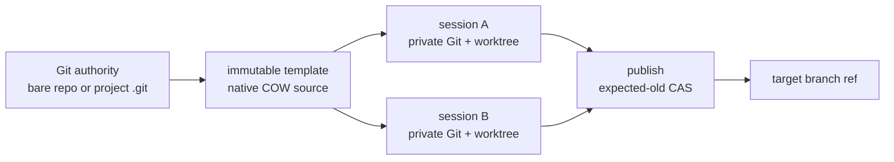

# git-vws

[CI workflow](.github/workflows/ci.yml)
[](LICENSE)

中文 | [English](docs/en/README.md)

`git-vws` 是一个 Git Extension，为同一仓库创建多个独立、可正常编辑的开发会话。每个会话都有私有的 HEAD、index、refs、未提交修改和构建输出；未修改的 Git 文件通过 macOS APFS 或 Linux 原生 FICLONE 写时复制共享物理数据。它不修改 Git、不引入 FUSE、守护进程、管理员安装或全量复制回退。

1.1.0 是当前支持 macOS 和 Linux 原生 COW 文件系统的稳定版本。发布或删除会话前，请先阅读命令输出和对应的恢复提示。

## 快速开始

先让 Git 在 `PATH` 中发现 `git-vws`，然后注册一个现有 bare 仓库或普通项目。普通项目会以其规范化的 `.git` 目录作为 authority；所有 git-vws 状态都位于 `$HOME/.git-vws`，不会在项目中创建 `.git-vws`。

```sh
git clone --bare <source-url> repo.git
git vws init repo.git
git vws --repo repo.git create feature-a --target feature/a
git vws --repo repo.git exec feature-a -- "$SHELL"
```

`create` 输出的 session root 下的 `worktree` 是可直接打开的普通工作目录。进入后照常使用 Git：

```sh
git status
git add .
git commit -m "Implement feature"
git vws --repo repo.git publish feature-a
git vws --repo repo.git remove feature-a
git vws gc
```

也可以注册普通项目：

```sh
git vws init .
git vws --repo . create fix-login --target fix/login
git vws --repo . exec fix-login -- cargo test
```

父项目工作目录不需要为 session 停止编辑。会话与父项目拥有独立的 Git 元数据；唯一的发布竞争点是目标 branch ref，`publish` 用 Git 的 expected-old CAS 防止覆盖其他发布者。

## 工作方式



会话中的 `worktree` 是正常可写目录，编辑器、编译器、调试器和原生 Git 命令都直接在其中运行。Git 文件的初始内容使用原生 COW 克隆；修改某个文件后，只有该会话持有自己的数据块。每个会话还拥有私有 `common.git`、HEAD、index 和 refs，因此 `status`、`diff`、`add`、`commit`、`checkout`、`reset`、`merge` 和 `rebase` 都按普通 linked worktree 的方式工作。

`publish` 不会自动提交。它只发布已提交的目标 branch：新目标、相同 tip 和快进都可完成；若目标在 CAS 前被其他发布者改动，则失败而不会覆盖远端状态。请在 session 内 rebase 或 merge 后再重试。

## 非 Git 缓存

`.vwscached` 是项目可提交的非 Git 目录缓存清单，适合 `target/`、`node_modules/`、`.gradle/` 等重建成本高的目录。它的方向与 `.gitignore` 相反：每个非空、非注释行都声明一个希望复用的仓库相对目录。

```text
# .vwscached
target/
node_modules/
.gradle/
```

创建 session 时，git-vws 会按当前 commit 和配置查找不可变快照；命中时为该 session 创建独立的可写原生 COW 副本，未命中时从普通项目目录中的对应目录建立快照。会话绝不直接共享可变的构建或依赖目录。完成构建后，在 Git 状态干净时运行：

```sh
git vws --repo . cache feature-a
```

缓存不会进入 commit 或 `publish`，并由会话私有的 Git excludes 配置排除在 status 之外。`git vws gc` 只回收没有 live session 引用的快照；`git vws doctor` 只诊断，不删除状态。详见[缓存配置](docs/zh/configuration.md)。

## 命令概览

```text
git vws init <repository-or-project>
git vws create <name> [--from <rev>] [--target <branch>] [--path <managed-path>]
git vws list [--all] [--human]
git vws exec <name> -- <program> [args...]
git vws cache <name>
git vws remove <name> [--force] [--human]
git vws publish <name>
git vws forget <path> [--force]
git vws doctor [--human]
git vws gc [--human]
git-vws man [--install]
```

面对自动化或陌生命令，先运行 `git vws -h`，再运行 `git vws <command> -h`。`list`、`doctor` 和 `gc` 默认输出 NDJSON，加 `--human` 可读；非零退出或 `*_RECOVERY_REQUIRED` 都应视为停止信号，先保留状态并运行 `doctor`，不要手动删除 `$HOME/.git-vws` 中的文件。

`git vws --help` 由 Git 转交给 `man`，首次使用前运行 `git-vws man --install` 安装手册页；在此之前用 `git vws -h`。

仓库被移动、改名或删除后，用 `git vws forget <旧路径>` 注销陈旧记录，再 `git vws init <新路径>`。

## 支持范围

- Git 2.34 或更新版本，构建需要 Rust 1.85 或更新版本。
- macOS 的 APFS，或同时提供 FICLONE 和可验证共享 FIEMAP extent 的 Linux 文件系统。
- Linux 上实测可用：XFS（`mkfs.xfs -m reflink=1`）、btrfs。**ext4 不支持**——它没有 reflink 能力，`FICLONE` 返回 `EOPNOTSUPP`；tmpfs、NFS、overlayfs 同样不支持。
- ext4 宿主可用 `sudo git vws setup-loop` 一次性把状态根放进稀疏 btrfs 镜像，之后以普通用户正常使用；详见[配置](docs/zh/configuration.md)。
- 不支持 Windows、LFS、submodule、sparse/partial clone、clean/smudge filter，以及不受支持的 ACL、xattr 或文件 flag 组合。

普通项目作为 authority 时，`publish` 只能更新该仓库所有 worktree 都未检出的分支；若目标可能被并发检出，请使用 bare authority。

不支持的存储会以 `STORAGE_UNSUPPORTED` 失败；git-vws 不会悄悄降级为完整工作区复制。

## 文档

| 主题 | English | 中文 |
| --- | --- | --- |
| 用户入口 | [README](docs/en/README.md) | 本页 |
| 架构与一致性 | [Architecture](docs/en/architecture.md) | [架构](docs/zh/architecture.md) |
| 缓存与参数 | [Configuration](docs/en/configuration.md) | [配置](docs/zh/configuration.md) |
| 开发与发布 | [Development](docs/en/development.md) | [开发与发布](docs/zh/development.md) |
| 安装与运维 | [Operations](docs/en/operations.md) | [运行与运维](docs/zh/operations.md) |

## 安装与验证

从 [Releases](../../releases) 下载当前平台的归档，使用 `SHA256SUMS` 校验后将其中的 `git-vws` 放到 `PATH`。每个 release 都包含各归档校验和、SPDX 2.3 SBOM、第三方许可证清单、构建元数据和 `PROVENANCE.sigstore.json`。

公开仓库使用 GitHub artifact attestation 与公共 Sigstore 服务。用 release notes 中的 source commit 和 signer workflow commit 验证产物：

```sh
gh attestation verify '<release-asset>' \
  --bundle PROVENANCE.sigstore.json \
  --repo '<owner>/git-vws' \
  --signer-workflow '<owner>/git-vws/.github/workflows/release-sign.yml' \
  --signer-digest '<signer-workflow-commit-from-release-notes>' \
  --source-digest '<source-commit-from-release-notes>' \
  --source-ref refs/tags/v1.1.0 \
  --deny-self-hosted-runners
```

## 许可证

Copyright (C) 2026 git-vws contributors. git-vws 使用 GNU General Public License, version 3 only (`GPL-3.0-only`) 发布，不提供任何担保。详见 [LICENSE](LICENSE)。
