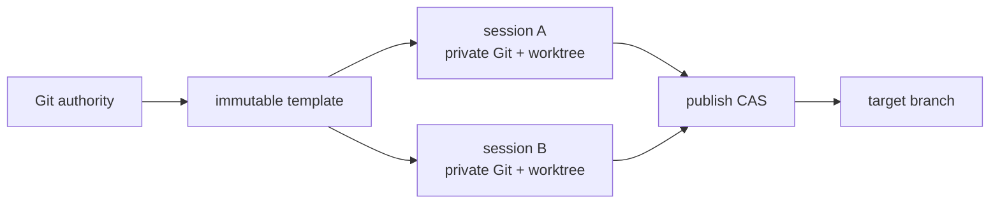

# git-vws

[CI workflow](../../.github/workflows/ci.yml)
[](../../LICENSE)

[English](README.md) | [中文](../../README.md)

`git-vws` is a Git Extension for creating independent, editable development sessions from one Git repository. Every session has private HEAD, index, refs, uncommitted changes, and build output. Unchanged Git files share physical storage through native copy-on-write on macOS APFS or supported Linux filesystems.

Version 1.1.0 is the stable release for the current macOS and Linux scope. git-vws does not modify Git, install FUSE or a daemon, require administrator access, or silently fall back to a full worktree copy.

## Quick start

Register an existing bare repository or ordinary project, then create a session. State is stored only under `$HOME/.git-vws`; git-vws never creates `.git-vws` inside the project.

```sh
git clone --bare <source-url> repo.git
git vws init repo.git
git vws --repo repo.git create feature-a --target feature/a
git vws --repo repo.git exec feature-a -- "$SHELL"
```

The editable directory is `<printed-session-root>/worktree`. Work there with ordinary Git commands, commit the result, and publish the target branch when ready:

```sh
git status
git add .
git commit -m "Implement feature"
git vws --repo repo.git publish feature-a
git vws --repo repo.git remove feature-a
git vws gc
```

An ordinary project can be registered directly:

```sh
git vws init .
git vws --repo . create fix-login --target fix/login
git vws --repo . exec fix-login -- cargo test
```

The parent project worktree is not locked by a session. Publish is the only shared branch operation: it uses Git expected-old compare-and-swap, so a concurrent writer changes the target into a conflict rather than an overwrite.

## How it works



Each session is an ordinary writable directory. Editors, compilers, debuggers, and native Git commands run directly in its worktree. The initial file tree is cloned with native COW, while every session owns its own Git common directory, linked-worktree metadata, HEAD, index, refs, and mutable files.

`publish` never creates a commit. It can create a new target, accept an unchanged tip, or fast-forward the expected old tip. If another writer updates the target first, publication fails without changing that writer's ref; rebase or merge in the session and retry.

## Non-Git cache directories

`.vwscached` is an optional, commit-friendly project file for expensive directories that Git does not track, such as `target/`, `node_modules/`, and `.gradle/`. It is the inverse of `.gitignore`: every nonempty, non-comment line is a repository-relative directory to reuse.

```text
# .vwscached
target/
node_modules/
.gradle/
```

On create, git-vws finds an immutable snapshot for the same commit and configuration, then makes each session its own writable native-COW copy. Sessions never share mutable build output or dependency trees. After building in a clean session, refresh the snapshot with:

```sh
git vws --repo . cache feature-a
```

Cache contents are excluded through private Git configuration, are never committed or published, and are reclaimed only when no live session references them. See [Configuration](configuration.md).

## Commands

```text
git vws init <repository-or-project>
git vws create <name> [--from <rev>] [--target <branch>] [--path <managed-path>]
git vws list [--all] [--human]
git vws exec <name> -- <program> [args...]
git vws cache <name>
git vws remove <name> [--force] [--human]
git vws publish <name>
git vws forget <path> [--force]
git vws doctor [--human]
git vws gc [--human]
git-vws man [--install]
```

Run `git vws -h` first, then `git vws <command> -h` before using an unfamiliar command. `list`, `doctor`, and `gc` emit NDJSON by default; add `--human` for a readable table. Treat every nonzero exit and `*_RECOVERY_REQUIRED` as a stop signal: preserve the state, run `doctor`, and do not delete `$HOME/.git-vws` by hand.

Git routes `git vws --help` to `man`, so run `git-vws man --install` once; until then use `git vws -h`.

After a repository is moved, renamed, or deleted, run `git vws forget <old-path>` to release the stale record, then `git vws init <new-path>`.

## Supported scope

- Git 2.34+ and Rust 1.85+ for builds.
- macOS APFS, or Linux filesystems with FICLONE and verified shared FIEMAP extents.
- Windows, LFS, submodules, sparse/partial clones, clean/smudge filters, and unsupported ACL, xattr, or file-flag combinations are outside this release.

Unsupported storage fails with `STORAGE_UNSUPPORTED`; there is no full-copy fallback.

## Documentation

| Topic | English | 中文 |
| --- | --- | --- |
| User entry | This page | [README](../../README.md) |
| Architecture and consistency | [Architecture](architecture.md) | [架构](../zh/architecture.md) |
| Cache and parameters | [Configuration](configuration.md) | [配置](../zh/configuration.md) |
| Development and releases | [Development](development.md) | [开发与发布](../zh/development.md) |
| Installation and operations | [Operations](operations.md) | [运行与运维](../zh/operations.md) |

## License

git-vws is free software under GNU General Public License, version 3 only (`GPL-3.0-only`). See [LICENSE](../../LICENSE).
