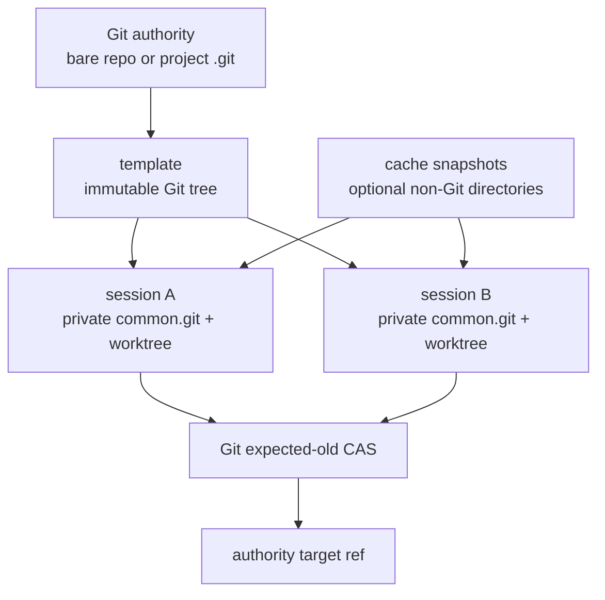

# Architecture

[English](architecture.md) | [中文](../zh/architecture.md) | [Back to English home](README.md)

git-vws does not introduce another version-control format. It uses native copy-on-write to create isolated development sessions from one Git authority without changing Git object, commit, ref, or index formats. A session remains an ordinary writable directory and Git operates in it as a normal linked worktree.

## Overall structure



An authority is an existing bare repository or the canonical `.git` directory of an ordinary project. Initialization verifies that it is a sole Git authority: `git-dir` and `common-dir` must match, with no linked-worktree registry or object alternates. git-vws neither converts a project into a bare repository nor changes the authority's Git storage format.

All git-vws records, templates, sessions, caches, and cleanup state live under `$HOME/.git-vws`. The project directory contains only project files; optional `.vwscached` is project configuration, not a git-vws state root.

## What a session contains

At create time, git-vws obtains an immutable template for the selected commit, then creates a private `common.git` and normal linked-worktree metadata beneath the session root. Git files from the template are native-COW cloned into `worktree`: unmodified data can share physical extents, while edits allocate private session blocks.

```text
$HOME/.git-vws/
  templates/              immutable source trees
  sessions/
    <session-id>/
      common.git/          private refs, HEAD, index-related metadata
      worktree/            normal writable linked worktree
  caches/                  immutable optional build/dependency snapshots
```

HEAD, index, branch state, uncommitted changes, and build output are therefore isolated per session. Open `<session-root>/worktree` in any editor or terminal and use `git status`, `diff`, `add`, `commit`, `checkout`, `reset`, `merge`, and `rebase` normally.

The parent project worktree is not a session lock. It can continue to be edited or committed; git-vws uses short leases only for its own session root. If the parent or another publisher changes the same target branch, that conflict appears at publish CAS rather than by blocking the parent worktree.

## Publishing and concurrency

Create records a session target branch and its expected old commit. `publish` handles only work already committed in that session's private Git state:

1. Validate the private commit closure and target relation.
2. Import any missing objects into the authority.
3. Update the target ref with Git expected-old compare-and-swap.

New branches, identical tips, and fast-forwards can succeed. If another writer updates the target first, or the session history is not fast-forward, publish fails without overwriting the authority ref. Rebase or merge in the session before another publish attempt. A session never blocks normal parent editing and two concurrent sessions cannot silently overwrite one target.

## Non-Git cache

`.vwscached` covers expensive directories Git does not track. A snapshot is scoped by authority identity, base commit, full configuration bytes, configured path, and the state-root volume. It is sealed as a read-only tree; every session still receives a separate writable COW copy, so `target/`, `node_modules/`, and `.gradle/` never become shared mutable directories.

The cache source is an ordinary project worktree, so a bare authority alone does not supply these directories. A missing configured directory records an empty selection instead of falling back to an old snapshot. After building, `git vws cache <name>` captures the current session HEAD for later sessions in the same scope.

## Failure and cleanup

Session, template, cache, and publish state are represented by verifiable records. Session removal first transitions through a tombstone. After interruption, `doctor` reports the state and `gc` removes only objects a complete census proves safe. Corrupt bindings, incomplete transactions, busy sessions, and uncertainty fail closed with stable recovery errors rather than speculative deletion.

`list`, `doctor`, and `gc` emit NDJSON. Paths and non-UTF-8 names use hexadecimal fields so scripts and agents preserve byte semantics. On `*_RECOVERY_REQUIRED`, `SESSION_CORRUPT`, or a related error, preserve the state, run `doctor`, and do not remove `$HOME/.git-vws` manually.

## Scope

The current implementation requires macOS APFS or a Linux filesystem with FICLONE and verified shared FIEMAP extents. Unsupported storage returns `STORAGE_UNSUPPORTED`; there is no full-copy fallback. Windows, LFS, submodules, sparse/partial clones, clean/smudge filters, and unsupported ACL, xattr, or file-flag combinations remain outside this release.
