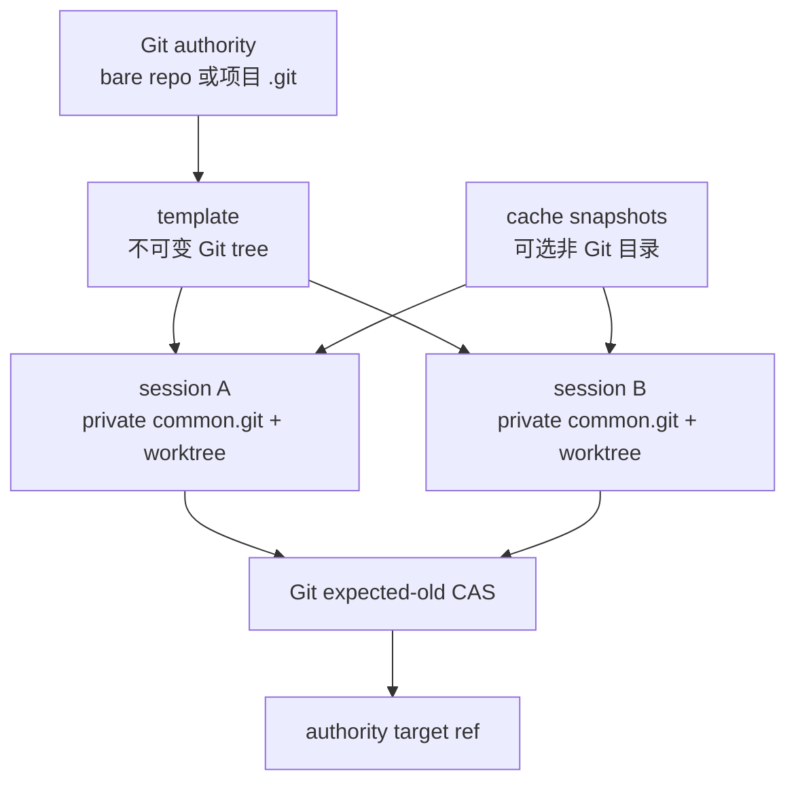

# 架构

[中文](architecture.md) | [English](../en/architecture.md) | [返回中文首页](../../README.md)

git-vws 的目标不是创造另一套版本控制系统，而是在不改 Git object、commit、ref 或 index 格式的条件下，用原生写时复制为同一 repository 提供多个隔离开发会话。每个会话都看起来像一个普通可写工作目录，Git 也以普通 linked worktree 的方式运行。

## 总体结构



一个 authority 是现有 bare repository，或普通项目的规范化 `.git` 目录。初始化会验证它是单一 Git authority：`git-dir` 与 `common-dir` 必须相同，不能已有 linked-worktree registry 或 object alternates。git-vws 不把普通项目转换成 bare repo，也不会更改 authority 的 Git 数据格式。

所有 git-vws 自己的记录、模板、session、缓存和回收状态都在 `$HOME/.git-vws`。项目目录只保留项目本身的文件；可选的 `.vwscached` 是用户维护的项目配置，而不是 git-vws 状态根。

## Session 的组成

创建 session 时，git-vws 先按起始 commit 获得不可变 template，再在 session root 下建立私有 `common.git` 和标准 linked-worktree 元数据。template 的 Git 文件被 native COW 克隆到 `worktree`；未修改的数据仍可共享物理 extent，修改写入当前 session 的私有块。

```text
$HOME/.git-vws/
  templates/              immutable source trees
  sessions/
    <session-id>/
      common.git/          private refs, HEAD, index-related metadata
      worktree/            normal writable linked worktree
  caches/                  immutable optional build/dependency snapshots
```

因此 session 的 HEAD、index、branch state、未提交修改和构建输出都与其他 session 隔离。用户可以直接把 `<session-root>/worktree` 打开到编辑器或终端；`git status`、`diff`、`add`、`commit`、`checkout`、`reset`、`merge`、`rebase` 都是原生 Git 操作。

父项目工作目录不是 session 的锁对象。它可以继续编辑或提交；git-vws 只对自己的 session root 做短时租约保护。若父项目或其他发布者更新同一目标 branch，冲突在 `publish` 的 CAS 边界显现，而不是通过锁住父工作目录解决。

## 发布与并发

每个 session 在 create 时记住其目标 branch 和当时的 expected old commit。`publish` 只处理已经提交到该 session 私有 Git 状态的内容：

1. 验证私有 commit closure 和目标关系。
2. 向 authority 导入缺失 object。
3. 用 Git 原生 expected-old compare-and-swap 更新目标 ref。

新 branch、相同 tip 和 fast-forward 可以成功。目标已被其他 writer 更新、或 session 提交不是 fast-forward 时，命令失败且不覆盖 authority ref；在 session 中 rebase 或 merge 后再发起新的 publish。一个 session 不会阻止父项目正常编辑，也不允许两个并发 session 静默覆盖同一个 target。

## 非 Git 缓存

`.vwscached` 仅处理 Git 不跟踪、但占用大或构建慢的目录。一个快照由 authority 身份、base commit、完整配置内容、目录路径和状态根所在 volume 共同限定。快照封存为只读树；每个 session 得到的仍是自己的可写 COW 副本，因此 `target/`、`node_modules/` 或 `.gradle/` 从不成为共享可变目录。

缓存输入来自普通项目工作目录，因此 bare authority 本身不会凭空提供此类目录。缺失的配置目录会以空选择记录，不会回退复用旧快照。session 完成构建后，以当前 HEAD 调用 `git vws cache <name>` 才会刷新后续同 scope session 使用的不可变快照。

## 故障与回收

session、template、cache 和发布过程均由可验证记录描述。删除 session 会先转换为 tombstone；中断后 `doctor` 报告现状，`gc` 只清理能被完整 census 证明安全的对象。损坏绑定、不完整事务、busy session 或不确定状态都会 fail closed，返回稳定的恢复错误而不是猜测性删除。

`list`、`doctor` 和 `gc` 采用 NDJSON，路径和非 UTF-8 名称以十六进制字段输出，便于脚本和 Agent 不丢失字节语义。看到 `*_RECOVERY_REQUIRED`、`SESSION_CORRUPT` 或类似错误时，先保存现场、运行 `doctor`，不要手工清理 `$HOME/.git-vws`。

## 边界

当前实现要求 macOS APFS，或支持 FICLONE 且能验证共享 FIEMAP extent 的 Linux 文件系统。未满足时返回 `STORAGE_UNSUPPORTED`，不会复制整个工作区作为替代。Windows、LFS、submodule、sparse/partial clone、clean/smudge filter 以及不受支持的 ACL、xattr 或 file flag 组合仍在当前范围之外。
